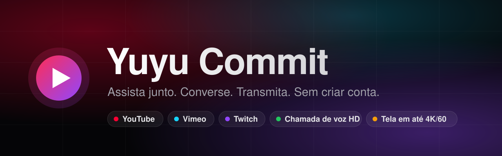
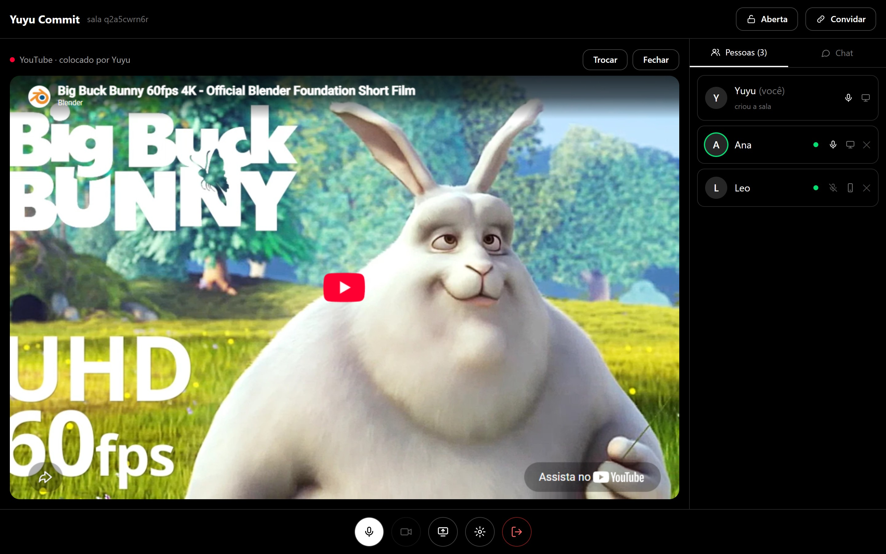
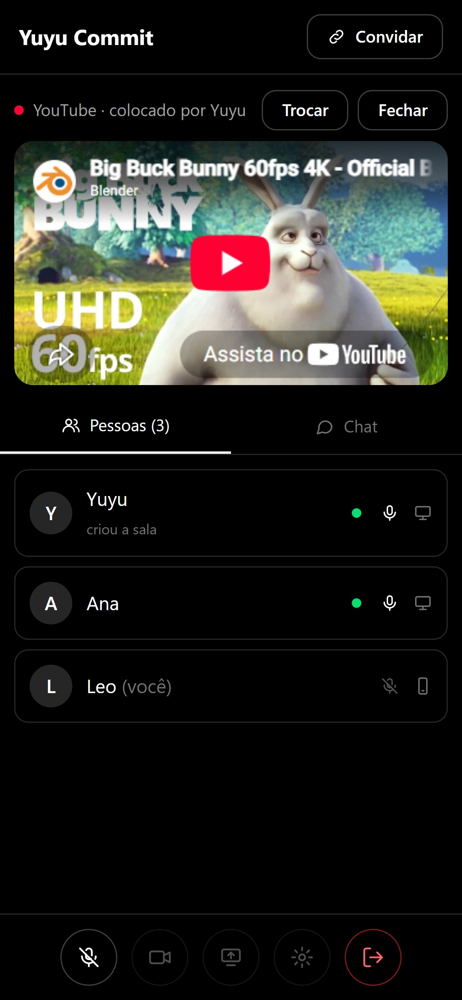
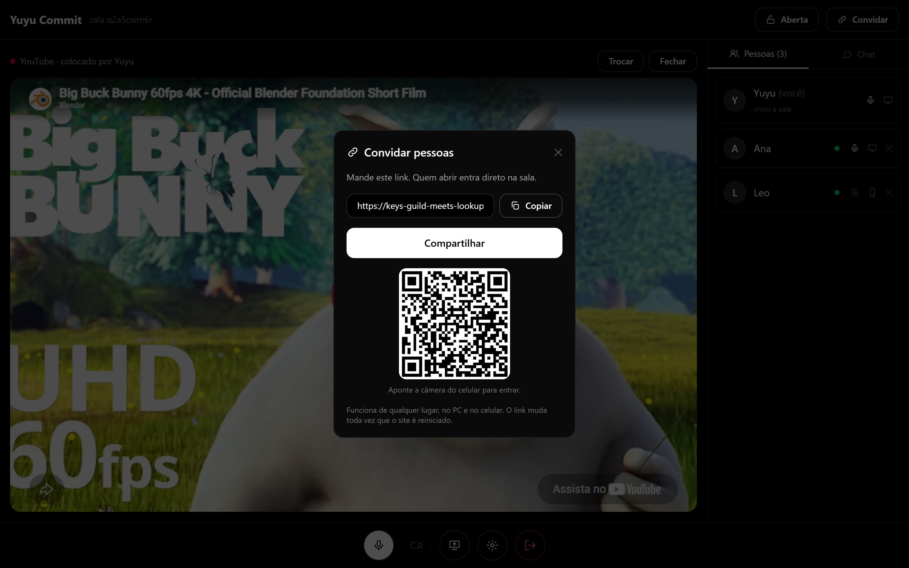
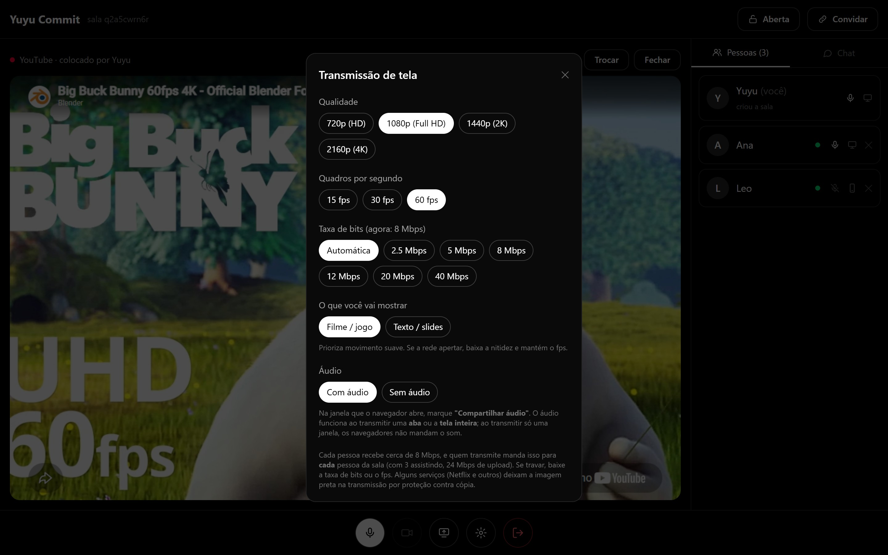
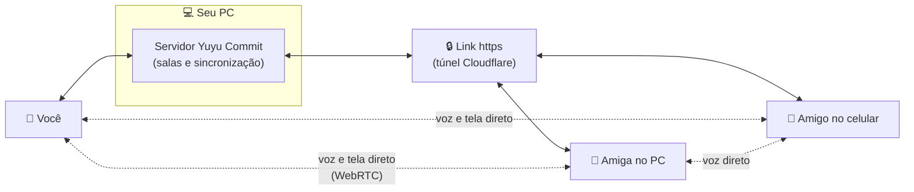

<p align="center">
  
</p>

<p align="center">
  <b>O seu cinema particular, direto do seu PC.</b><br>
  Crie uma sala, mande o link e assista junto com quem quiser — no PC ou no celular.<br>
  Sem cadastro, sem mensalidade, sem servidor de ninguém no meio.
</p>

<p align="center">
  <a href="#-comece-em-3-passos"></a>
  
  
  
</p>

<br>

<p align="center">
  
</p>

---

## ✨ Tudo o que você precisa para assistir junto

<table>
  <tr>
    <td width="33%" valign="top">
      <h3>🎬 Assista sincronizado</h3>
      YouTube, Vimeo e Twitch dentro da sala. Alguém dá play, pausa ou pula — <b>todo mundo acompanha no mesmo segundo</b>. Quem entra no meio já começa no ponto certo.
    </td>
    <td width="33%" valign="top">
      <h3>🎙️ Chamada de voz HD</h3>
      Voz em <b>Opus 128 kbps</b>, com cancelamento de eco, redução de ruído e indicação de quem está falando. O áudio vai direto entre as pessoas.
    </td>
    <td width="33%" valign="top">
      <h3>🖥️ Transmita a sua tela</h3>
      De <b>720p a 4K</b>, de 15 a 60 fps, taxa de bits e áudio configuráveis — e dá para mudar <b>durante</b> a transmissão.
    </td>
  </tr>
  <tr>
    <td width="33%" valign="top">
      <h3>🔗 Um link e pronto</h3>
      Nada de contas. Crie a sala, toque em <b>Convidar</b> e mande o link (ou mostre o QR code). Quem abrir, entra.
    </td>
    <td width="33%" valign="top">
      <h3>📱 Feito para o celular também</h3>
      No celular dá para assistir, conversar e ver a tela transmitida — com tela cheia deitada e a tela sempre acesa.
    </td>
    <td width="33%" valign="top">
      <h3>🛡️ A sala é sua</h3>
      Códigos impossíveis de adivinhar, sala que fecha sozinha quando esvazia, e quem criou pode <b>bloquear</b> a entrada e <b>remover</b> pessoas.
    </td>
  </tr>
</table>

<p align="center">
  
  &nbsp;
  
  &nbsp;
  
</p>

---

## 🚀 Comece em 3 passos

O Yuyu Commit roda **no seu próprio PC**. Você liga, e os seus amigos entram pelo link — de casa, do 4G, de onde estiverem.

### 1. Instale o Node.js

Baixe a versão **LTS** (20 ou mais nova) em **[nodejs.org](https://nodejs.org)** e instale normalmente.

### 2. Baixe o Yuyu Commit

Clique em **Code → Download ZIP** aqui em cima e extraia a pasta onde quiser.
Ou, se você usa git:

```bash
git clone https://github.com/Yuyusukii/yuyu-commit.git
```

### 3. Dê dois cliques no `iniciar.bat`

Na primeira vez ele instala o que precisa e pergunta se pode baixar o **cloudflared** — responda **S**.
É o programa oficial e gratuito da Cloudflare que cria o seu **link https**, o que faz os convites funcionarem de qualquer lugar e libera o microfone no celular.

Quando aparecer isto na janela preta, está no ar:

```text
  Yuyu Commit está rodando!

  Neste PC:            http://localhost:3000
  Mesmo Wi-Fi:         http://192.168.0.10:3000

  Link https pronto:   https://alguma-coisa.trycloudflare.com
```

Abra **http://localhost:3000**, crie a sala e toque em **Convidar**. 🍿

> **Deixe a janela preta aberta** enquanto estiverem assistindo — ela é o servidor da sua sala. Fechou, desligou.
>
> Na primeira vez que alguém entrar, o Windows pode perguntar se o Node.js pode usar a rede: clique em **Permitir**.

<details>
<summary><b>Usa macOS ou Linux?</b></summary>

<br>

Com o Node.js 20+ instalado, rode na pasta do projeto:

```bash
npm install
npm run build
npm start
```

Para o link https, instale o `cloudflared` pelo gerenciador do seu sistema (por exemplo, `brew install cloudflared`). O Yuyu Commit encontra ele sozinho e abre o túnel ao iniciar.

</details>

---

## 📺 O que dá para assistir

| Plataforma | Como funciona |
|---|---|
| **YouTube** | Cole o link — toca dentro da sala, sincronizado. |
| **Vimeo** | Cole o link — toca dentro da sala, sincronizado. |
| **Twitch** | Lives: todo mundo no mesmo canal ao vivo. Vídeos gravados: sincronizados. |
| **Netflix, Prime Video, Disney+, HBO Max, Globoplay** | Esses serviços não permitem colocar os vídeos em outros sites. Quem tem a conta abre no PC e **transmite a tela** para a sala. |

> Alguns serviços pagos deixam a imagem preta em transmissões de tela por proteção contra cópia — isso é do serviço, não do Yuyu Commit.

---

## ⚙️ Como funciona por dentro



- **O servidor é o seu PC.** Ele só cuida das salas, de quem está em cada uma e do play/pausa. Nada de banco de dados: as salas existem enquanto o servidor estiver ligado.
- **Voz e tela vão direto entre as pessoas** (WebRTC), com qualidade alta e sem passar pelo servidor.
- **O link https** vem de um túnel gratuito da Cloudflare, que muda a cada vez que você inicia.

| | |
|---|---|
| 👥 Pessoas por sala | até **8** |
| 🎙️ Voz | Opus 128 kbps, eco e ruído tratados |
| 🖥️ Tela | 720p · 1080p · 1440p · 4K — 15/30/60 fps — 2,5 a 40 Mbps |
| 🌐 Navegadores | Chrome, Edge, Firefox 128+, Safari / iPhone com iOS 16.4+ |

> Quem transmite envia o vídeo para **cada** pessoa da sala: em 1080p a 5 Mbps com 3 pessoas assistindo, são ~15 Mbps de upload.

---

## 🔒 Privacidade e segurança

- **Sem contas, sem e-mail, sem rastreadores.** Só um apelido, se você quiser.
- **Seus dados ficam com você:** o servidor é o seu PC e não guarda nada em disco.
- **Salas protegidas:** códigos aleatórios de 10 caracteres, limite de tentativas contra quem tenta adivinhar códigos, bloqueio de entrada e remoção de pessoas.
- **Página blindada:** regras de segurança do navegador (CSP), proteção contra o site ser embutido em outros e microfone/câmera/tela liberados só para o próprio site.

---

## 🧰 Resolvendo problemas

| Problema | Solução |
|---|---|
| "A porta 3000 já está em uso" | O Yuyu Commit já está aberto em outra janela. Use aquela ou feche-a. |
| "Link https: desligado" | O cloudflared não foi baixado. Apague `ferramentas\nao-perguntar` e rode o `iniciar.bat` de novo. |
| Amigo no mesmo Wi-Fi não abre | Libere o Node.js no Firewall do Windows (redes privadas). |
| Celular sem botão de microfone | Ele entrou pelo link `http://192.168…`. Mande o link **https** do convite. |
| Entra, mas não ouve nem vê nada | Algumas redes (às vezes o 4G) bloqueiam conexão direta. Veja "Servidor TURN" abaixo. |
| "Sala não encontrada" | A sala fechou por ficar vazia ou o site foi reiniciado. É só criar outra. |
| Vídeo do YouTube não toca | O dono do vídeo bloqueou tocar fora do YouTube. Tente outro. |
| Twitch não toca | Use o link https e clique no play **dentro** do player da Twitch. |

---

## 🛠️ Configurações avançadas

Variáveis de ambiente opcionais, definidas antes de iniciar:

| Variável | Para quê |
|---|---|
| `PORT` | Porta do site (padrão `3000`). |
| `SEM_TUNEL=1` | Não abre o link https. |
| `LINK_PUBLICO` | Usa um endereço seu (ex.: domínio próprio) nos convites. |
| `TURN_URL`, `TURN_USUARIO`, `TURN_SENHA` | Servidor TURN para redes que bloqueiam conexão direta. |

<details>
<summary><b>Para quem quer mexer no código</b></summary>

<br>

| Pasta | O que tem |
|---|---|
| `server/` | Node + Express + Socket.IO: salas, sincronização, sinais da chamada, túnel e segurança. |
| `client/` | React + Tailwind: páginas, players (YouTube, Vimeo, Twitch), chamada e transmissão (WebRTC). |
| `testes/` | Auditoria de segurança e teste de carga do servidor. |

```bash
npm run build              # gera o site em dist/
npm start                  # liga o servidor
npm run teste:seguranca    # simula ataques e confere as defesas (com o site ligado)
npm run teste:desempenho   # 48 pessoas em 6 salas por 1 minuto, medindo a memória
```

</details>

<br>

<p align="center">
  <sub>Feito para assistir junto com quem importa. 🍿</sub>
</p>
